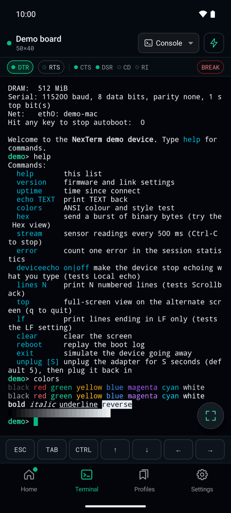
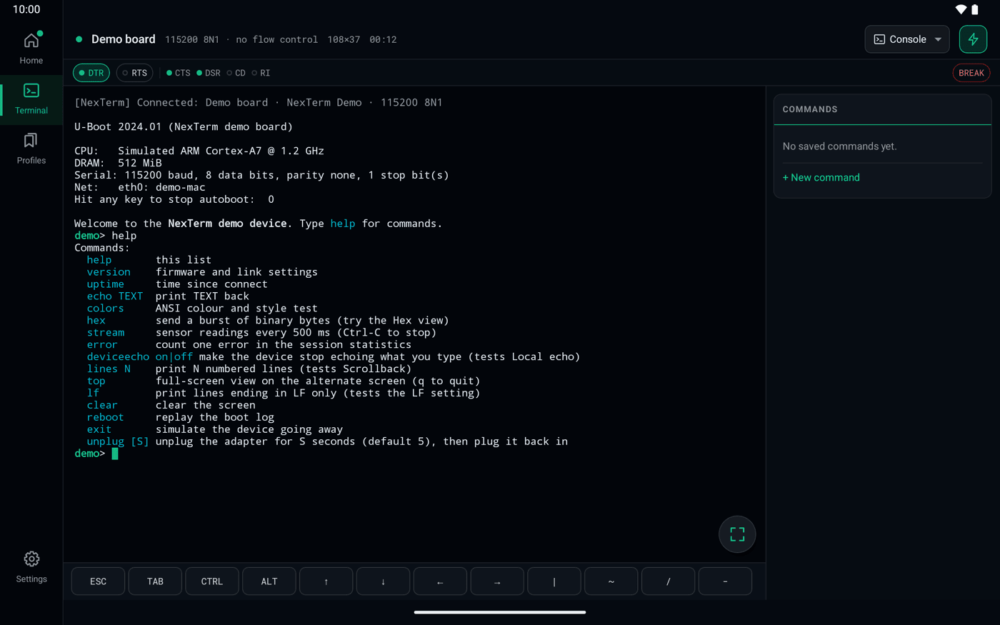

# Control lines and BREAK

Besides the data wires, a serial link has a few **control lines**. Some adapters and boards use them to reset the board, to enter its boot loader, or to say that they are ready. NexTerm shows them on a bar under the header of the [Terminal](terminal.md), and lets you change two of them and send a BREAK.

## The bar

=== "Phone"

    [{ width="300" loading=lazy }](../start/img/first-connection-4-console.png){ target=_blank }

=== "Tablet"

    [{ loading=lazy }](img/terminal-1-console-tablet.png){ target=_blank }

| Line | Direction | What the bar does |
|---|---|---|
| DTR | Output, from NexTerm | A pill with a lamp: tap it to switch the line on or off. |
| RTS | Output, from NexTerm | The same. |
| CTS | Input, from the device | A lamp that shows the state; nothing to tap. |
| DSR | Input | The same. |
| CD | Input | The same. |
| RI | Input | The same. |
| BREAK | Output | A button that sends a BREAK of 100 ms and says “BREAK sent (100 ms)”. |

A **lit lamp** means the line is on. A line that the adapter cannot handle is **dimmed**, and so is RTS when the flow control is RTS/CTS, because then the chip drives it by itself. If an adapter has no control lines at all, the bar is not shown.

!!! note "Some boards reset when DTR or RTS change"
    ESP32 and Arduino boards, among others, reset, or enter their boot loader, when DTR and RTS change: that is how programming tools restart them. NexTerm sets DTR and RTS to the state you chose in the [Settings](settings.md#connection) when the port opens, so a board may restart when you connect. By default DTR is on and RTS is off; turn DTR off in the Settings if your board resets and you do not want it to.

## What the adapter knows

What each adapter can do depends on its chip. The details of the adapter on [Home](home.md#the-details-of-an-adapter) list, under “Control lines”, the lines its driver handles, and under “Flow control” the modes it supports.

## Hiding the bar

**Control lines** in Settings, App hides the bar. On a phone held sideways, where the signals sit inside the header, it also removes them from there. DTR, RTS and BREAK are then out of reach, so turn the switch back on when you need them.
