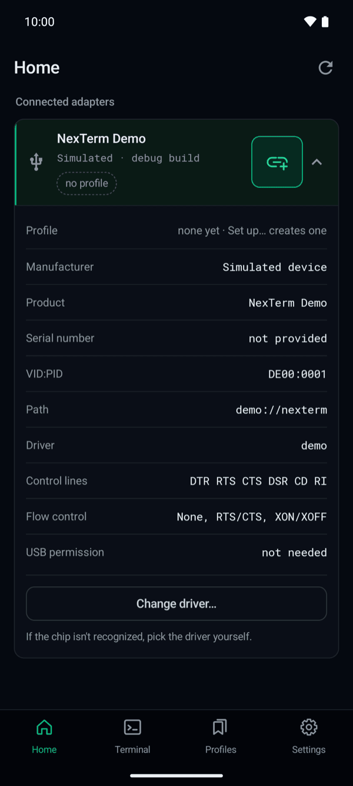
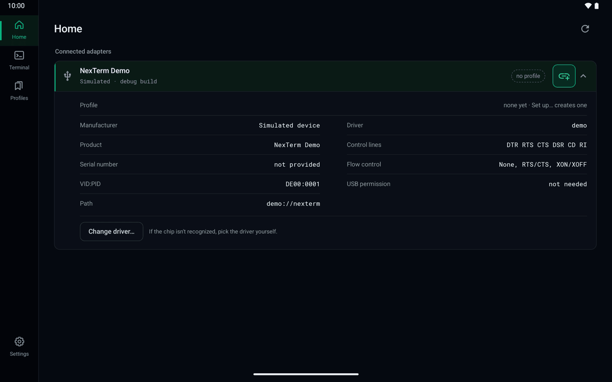
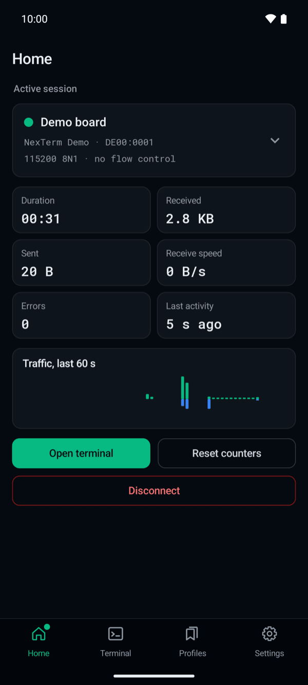
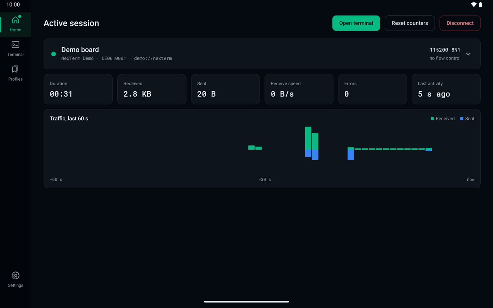

# Home: adapters and sessions

**Home** is where you find the adapters that are plugged in, start a session, and watch it. It has two states: the **list of adapters**, when no session is open, and the **session**, when one is. NexTerm keeps one session at a time. The images enlarge with a click.

## The list of adapters

The list is called **Connected adapters** and it follows you plugging and unplugging. The refresh button at the top forces an update. NexTerm lists **every USB device** that is plugged in, serial or not, so that you can also tell it how to use one it does not recognise.

Each card has:

- the **name** of the adapter, as it tells itself (“USB device” if it gives none), and under it its **VID:PID** (on a wide window, also its path);
- a **chip**: the name of the profile the adapter will connect with, or “no profile”;
- a square button on the right:

| Button | Where | What it does |
|---|---|---|
| **Connect** (two plugs) | The adapter has a profile | Opens the session with that profile. Android asks for the USB permission. |
| **Set up…** (a link with a plus) | It has no profile | Opens the form of the parameters, with the option to keep them as a profile. See [First connection](../start/first-connection.md#2-set-it-up). |
| **Choose driver…** | NexTerm found no driver | Opens the choice of the driver: see [Adapters and drivers](../reference/adapters.md#when-the-driver-is-not-detected). The card says “no driver detected” in red. |

An adapter with several profiles connects with the one you used last, or else the first one you saved for it. To use another, open the details and choose it in the **Profile** row.

## The details of an adapter

Tap a card to open its details.

=== "Phone"

    [{ width="300" loading=lazy }](img/interface-1-adapter-details.png){ target=_blank }

=== "Tablet"

    [{ loading=lazy }](img/interface-1-adapter-details-tablet.png){ target=_blank }

| Row | What it says |
|---|---|
| Profile | The profile the adapter will use. With more than one, a menu to choose. |
| Manufacturer, Product, Serial number | What the adapter reports about itself; “not provided” when it does not. |
| VID:PID | The USB identifier of the model: the profiles and the driver choice are kept by it. |
| Path | Where Android has put the device. It changes every time you plug it in. |
| Driver | The driver in use. “Chosen by you” if you forced it. |
| Control lines | The lines the driver handles: [Control lines and BREAK](control-lines.md). |
| Flow control | The modes the driver supports: None, RTS/CTS, DTR/DSR, XON/XOFF. |
| USB permission | “Granted”, or “Not requested” until you connect. |

**Change driver…** is at the bottom. It is off while a session is open: “To change the driver, disconnect first.”

## The active session

When you connect, the list gives way to the session.

=== "Phone"

    [{ width="300" loading=lazy }](../start/img/first-connection-3-session.png){ target=_blank }

=== "Tablet"

    [{ loading=lazy }](../start/img/first-connection-3-session-tablet.png){ target=_blank }

The first card is the session: a green lamp, the name of the profile (“Quick connect” if you did not save one), the adapter and its VID:PID, and the serial settings. Tap it for the details of the adapter, as above. Under it, the **statistics**:

| Tile | What it counts |
|---|---|
| Duration | The time since the session opened. |
| Received, Sent | The bytes that came in and went out. |
| Receive speed | The bytes per second coming in now. |
| Errors | The writes that did not get out: they timed out, typically because flow control is holding the line. |
| Last activity | How long ago the last byte went by, in either direction. |

**Traffic, last 60 s** is a chart with a column for each second: **received** bytes go up from the middle line in green, **sent** bytes go down in blue, and each direction has its own scale, so the few bytes you type stay visible next to a busy line. On a wide screen a legend names the colours and the chart has a time axis, from “-60 s” to “now”.

The buttons, which sit in the header on a tablet: **Open terminal** goes to the [Terminal](terminal.md); **Reset counters** puts the statistics back to zero without touching the session; **Disconnect** ends it. The Home icon has a green dot while a session is connected.

## When a session ends

A session ends when you tap **Disconnect**, when the adapter is unplugged, or when the link fails. Home then shows **Session ended**, with the statistics frozen and the chart dimmed, and a chip that says whether the adapter is “Adapter connected” (a green pill) or “Adapter unplugged”.

- **Reconnect** opens the same session again, with the same adapter and profile and the counters at zero.
- **Close** goes back to the list of adapters.

If the session did not end because of you, a **notice** at the top says why: “The … adapter was unplugged.” or “The connection was lost: …”. You can dismiss it. With [Auto-reconnect](settings.md#connection) on and the adapter unplugged, the notice adds that NexTerm is waiting for it to come back, and the session resumes on its own when you plug it in again: you only have to tap **OK** on Android's USB permission window.

!!! note "Auto-reconnect resumes only after an unplug"
    It does not restart after a manual Disconnect, nor after a link error while the adapter is still plugged in. If NexTerm is in the background or the screen is locked when you plug the adapter back in, it waits until you open the app.

## While NexTerm is in the background

An open session keeps running when you leave the app, and NexTerm shows an ongoing notification, “Serial session active”, with a **Disconnect** button; tapping the notification opens the Terminal. While it waits for an unplugged adapter the notification says “Waiting for the adapter”, with a **Stop waiting** button. The notification can be hidden by refusing the permission to show notifications: the session works all the same.

## No adapter

If nothing is plugged in, Home says “No adapter connected”: plug the adapter in with the OTG cable. Android asks for the permission to use it when you tap Connect. The **Refresh list** button looks again. If the adapter does not appear, see [Troubleshooting](../reference/troubleshooting.md#the-adapter-is-not-listed).
