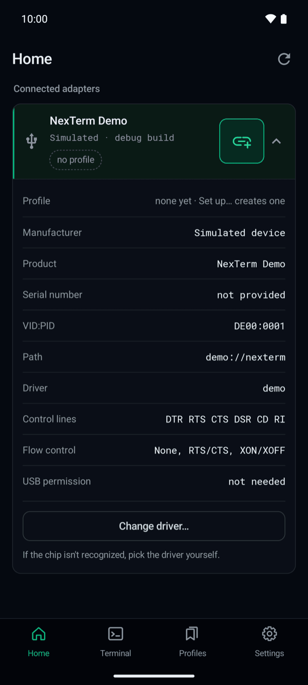
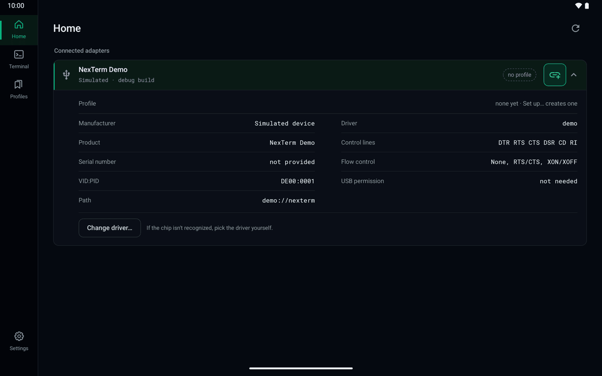
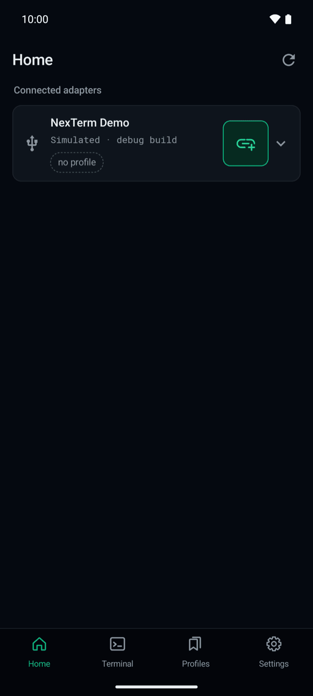
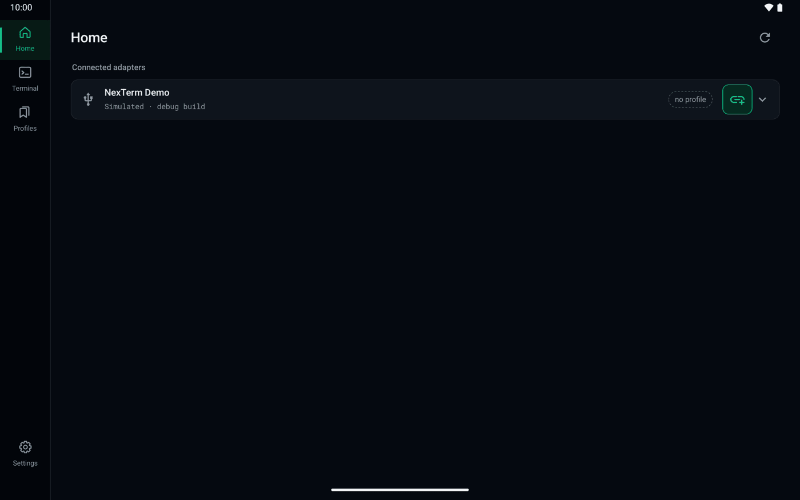
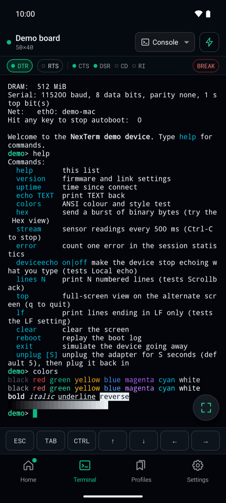
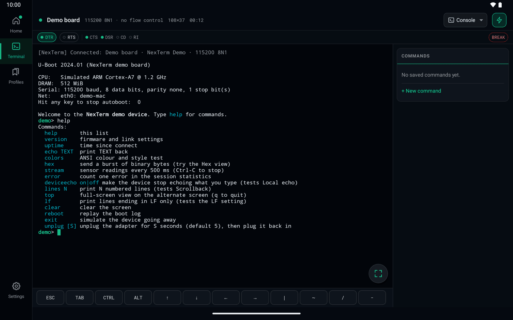
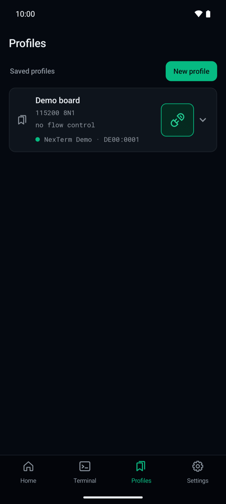
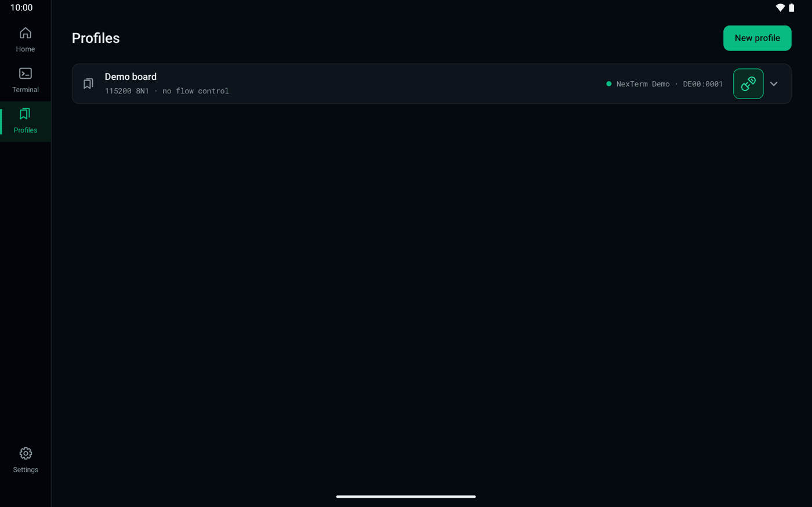
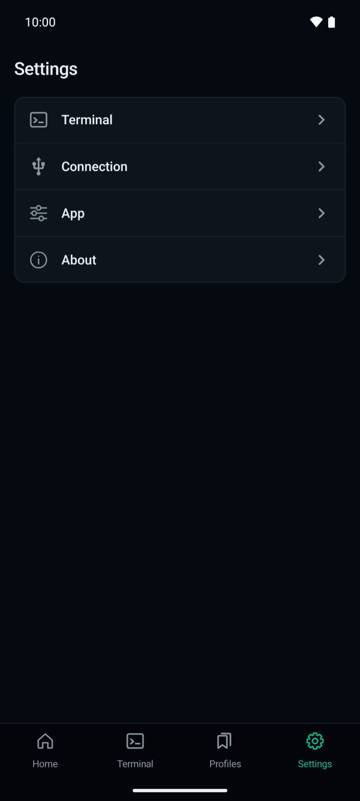
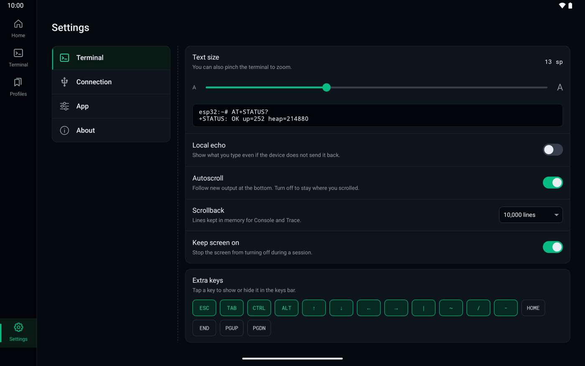

# Interface tour

NexTerm has **four screens**: Home, Terminal, Profiles and Settings. This chapter gives a name to each of them and to the parts that come back everywhere. **The names are the ones used throughout the guide.** The images enlarge with a click.

## The four screens

| Screen | What it is for | Chapter |
|---|---|---|
| **Home** | The adapters that are plugged in, and the session: statistics and traffic. | [Home: adapters and sessions](home.md) |
| **Terminal** | What the device sends and what you send back, in three views. | [Terminal](terminal.md), [Sending data](sending.md), [Control lines and BREAK](control-lines.md) |
| **Profiles** | The saved serial settings of your adapters. | [Profiles](profiles.md) |
| **Settings** | The text, the connection and the look of the app. | [Settings](settings.md) |

You move between them with the **bottom bar** on a phone held upright, and with the **rail** on the left on a tablet or on a phone held sideways: the layout follows the width of the window, not the kind of device, and it changes by itself when you rotate. The bar and the rail have the same four entries, with Settings at the end. The Home icon shows a **green dot** while a session is connected. The **Button labels** setting takes the names away from under the icons. Details in [Phones and tablets](phones-and-tablets.md).

=== "Phone"

    [{ width="300" loading=lazy }](img/interface-1-adapter-details.png){ target=_blank }

=== "Tablet"

    [{ loading=lazy }](img/interface-1-adapter-details-tablet.png){ target=_blank }

The **Back** gesture of Android goes from any screen to Home, and from Home it leaves the app.

## One session at a time

NexTerm keeps **one session**: one adapter open. While it is open, Home shows it instead of the list of adapters, and the Terminal shows its traffic. To use another adapter, disconnect first.

## Home

The list of the adapters with a button for each, and then the session with its statistics.

=== "Phone"

    [{ width="300" loading=lazy }](../start/img/first-connection-1-adapters.png){ target=_blank }

=== "Tablet"

    [{ loading=lazy }](../start/img/first-connection-1-adapters-tablet.png){ target=_blank }

## Terminal

A header with the name of the session, the view button and the commands button; the bar of the control lines; the terminal; and under it the extra keys or, in Trace and Hex, the send field.

=== "Phone"

    [{ width="300" loading=lazy }](../start/img/first-connection-4-console.png){ target=_blank }

=== "Tablet"

    [{ loading=lazy }](img/terminal-1-console-tablet.png){ target=_blank }

## Profiles

One row for each saved profile, with its settings and a button to connect.

=== "Phone"

    [{ width="300" loading=lazy }](img/interface-2-profiles.png){ target=_blank }

=== "Tablet"

    [{ loading=lazy }](img/interface-2-profiles-tablet.png){ target=_blank }

## Settings

The settings are in four sections: Terminal, Connection, App and About.

=== "Phone"

    [{ width="300" loading=lazy }](img/settings-1-sections.png){ target=_blank }

=== "Tablet"

    [{ loading=lazy }](img/settings-1-sections-tablet.png){ target=_blank }

## The buttons that only have an icon

Some buttons show an icon and no words. Screen readers read their names, and here they are:

| Icon | Name | Where |
|---|---|---|
| Two plugs | **Connect** | Home and Profiles |
| A link with a plus | **Set up…** | Home |
| A circular arrow | **Refresh adapters** | Home |
| A bolt | **Commands** | The header of the Terminal |
| A pencil | **Edit** | Beside each saved command |
| Four corners | **Full screen** | The round button on the terminal |
| An arrow pointing up | **Send** | The send field of Trace and Hex |

The names of the views (Console, Trace, Hex), of the screens and of the buttons of the windows keep their text.
