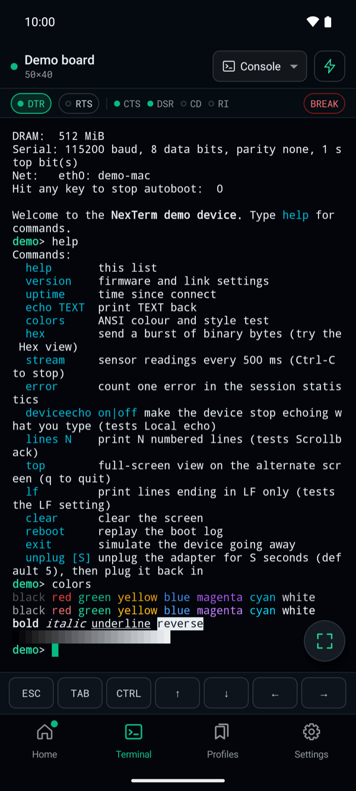
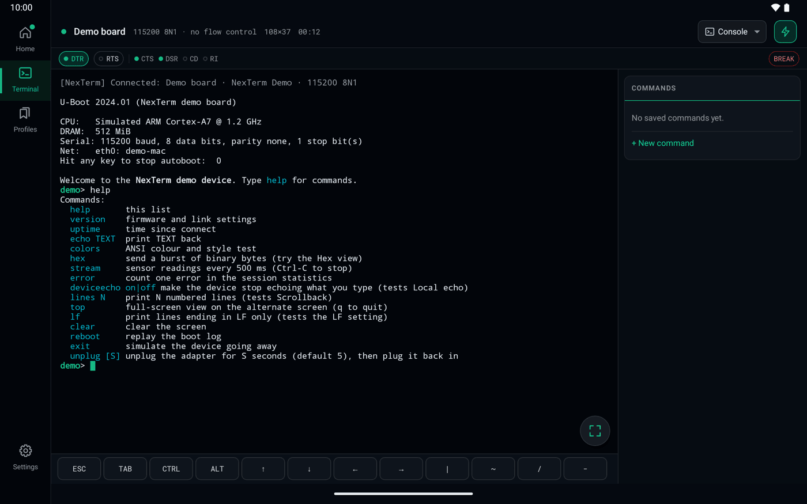
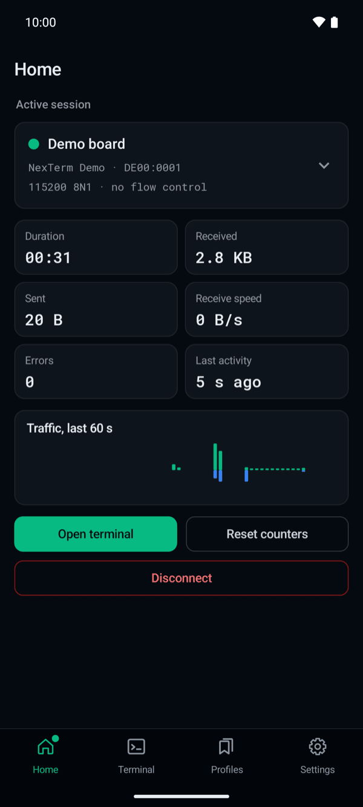
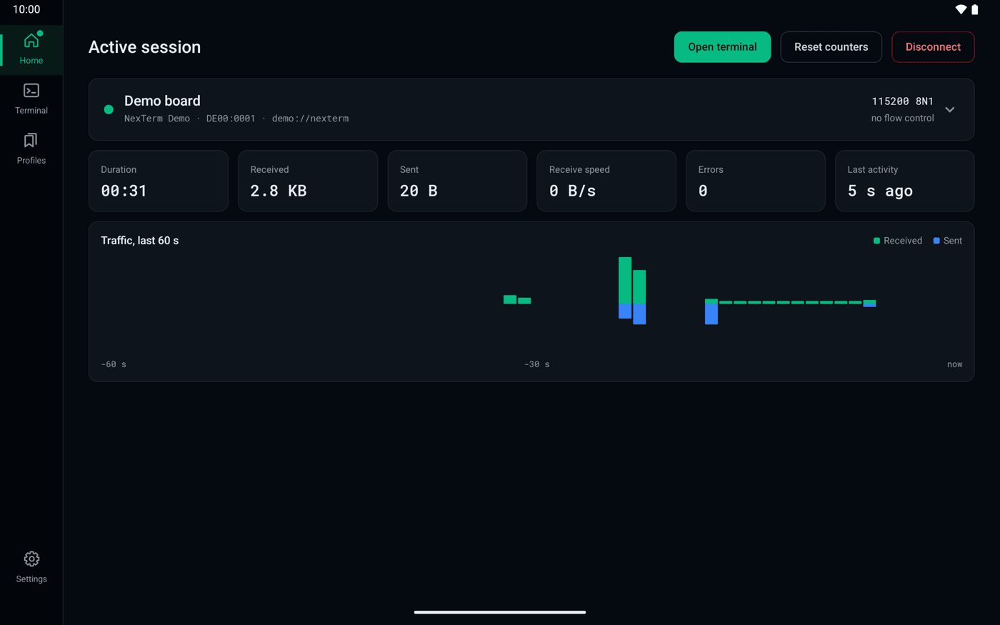

# Phones and tablets

NexTerm has no separate versions for phones and tablets: **the layout follows the width and the height of the window**, not the kind of device. A tablet held upright, a phone held sideways and a window of a split screen all get the layout that fits them, and it changes by itself when you rotate. The session carries on while it does. The images enlarge with a click.

## What changes with the width

| Window | Navigation | Commands | Terminal header |
|---|---|---|---|
| **Under 600 dp** wide (a phone upright) | A bar at the bottom | A popup | The name, with the size of the terminal under it |
| **600 dp** and more (a tablet, a phone sideways) | A rail on the left | A popup | The name, the serial settings, the size and the time of the session |
| **1000 dp** and more (a tablet) | A rail on the left | A **dock** beside the terminal, open from the start | As above |

“dp” is the unit Android uses for sizes on the screen: a phone is about 360 to 430 dp wide held upright, and a tablet 600 dp or more.

=== "Phone"

    [{ width="300" loading=lazy }](../start/img/first-connection-4-console.png){ target=_blank }

=== "Tablet"

    [{ loading=lazy }](img/terminal-1-console-tablet.png){ target=_blank }

## What changes with the height

A phone held **sideways** is short, under 500 dp. Then:

- the rail is narrower;
- the header of the Terminal and the bar of the control lines become one row: the signals move inside the header;
- the serial settings and the time of the session are left out of the header.

When the window is short, the round **full screen** button of the Terminal is the quickest way to get more lines.

## Home

Home takes the room it has. On a phone the statistics are tiles in two columns and the buttons are under them; on a tablet the tiles are in one or two rows, the chart has a legend and a time axis, and the buttons are in the header.

=== "Phone"

    [{ width="300" loading=lazy }](../start/img/first-connection-3-session.png){ target=_blank }

=== "Tablet"

    [{ loading=lazy }](../start/img/first-connection-3-session-tablet.png){ target=_blank }

## Settings and forms

The [Settings](settings.md) are a list of pages on a phone and two columns on a wide window. The form **Set up connection** is a sheet that comes up from the bottom of a phone and a window in the middle of a tablet.

## Rotating

Rotating does not restart the app or end the session. The terminal takes its new size in columns and rows, the pop-up menus close, and the round full screen button keeps a place for each orientation.

## The keyboard

On a phone the keyboard covers part of the Terminal, and the bar of the Terminal that has the send field goes up above it. Tap the console to bring the keyboard up; the Back gesture of Android puts it away.
