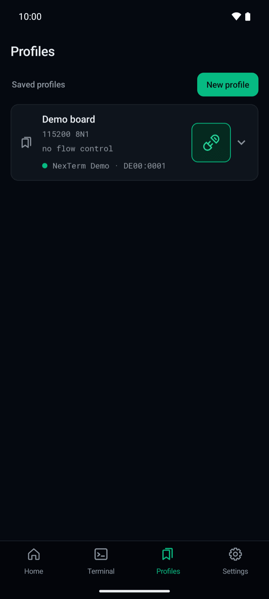
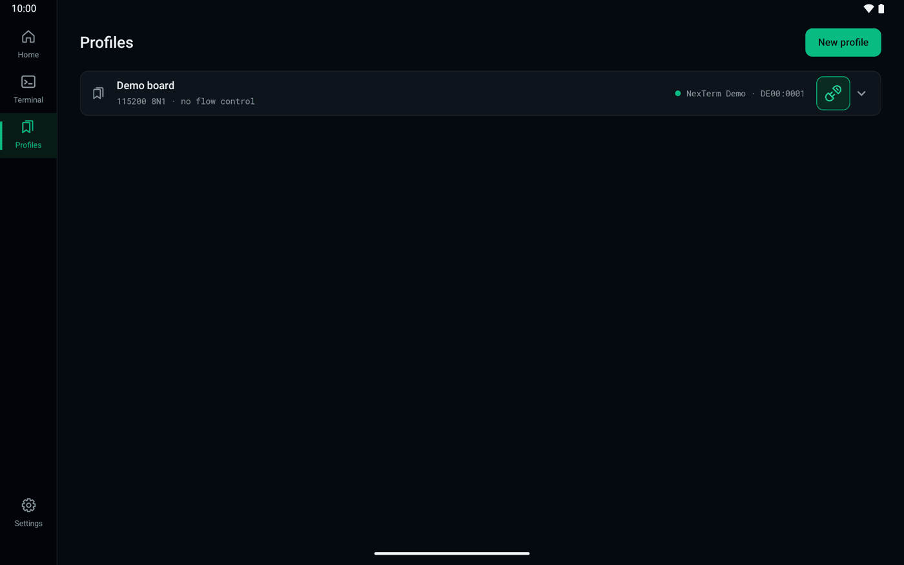
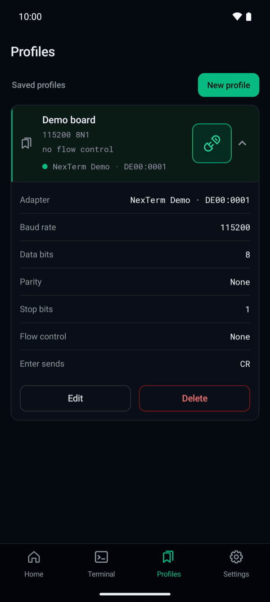
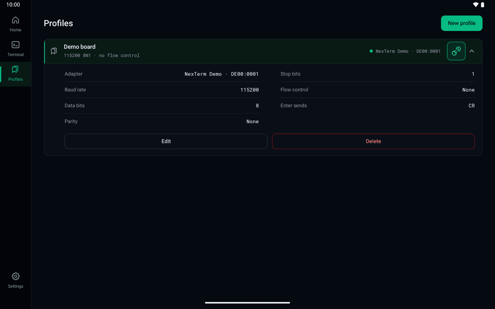

# Profiles

A **profile** saves the serial settings of an adapter, so that you connect with one tap. This chapter shows the list of profiles and how to make, change and remove them. The images enlarge with a click.

## What a profile keeps

| Setting | What it is |
|---|---|
| Name | Whatever you like. Two profiles cannot have the same name, capitals aside. |
| Adapter | The **model** of the adapter, by its VID:PID, and the path where it was last seen. |
| Port | Which port to open, for adapters that have more than one (some FTDI chips). Only shown then. |
| Baud rate | From 300 to 1,500,000 on the list, or any value with “Custom…”. |
| Data bits | 5, 6, 7 or 8. |
| Parity | None, Even, Odd, Mark or Space. |
| Stop bits | 1 or 2. |
| Flow control | None, RTS/CTS or XON/XOFF. |
| Enter sends | CR, LF or CR+LF. |
| Received LF starts a new line | For devices that end their lines with LF only: without it, the output steps diagonally down the screen. |

!!! note "A profile belongs to a model, not to a plug"
    Because the profile remembers the VID:PID, it works with any adapter of the same model, and it finds its adapter again after you plug it into another port. If the remembered path is gone, NexTerm uses the attached adapter with the same VID:PID and says so in the session. If two identical adapters are plugged in, it takes the first and tells you that several matched.

## The list of profiles

Tap **Profiles** in the bar. Each profile is a row: its name, its settings in one line (“115200 8N1 · no flow control”), a green lamp with the name of the adapter when that adapter is plugged in, and a button: **Connect**, or a **Connected** pill while the session is open.

=== "Phone"

    [{ width="300" loading=lazy }](img/interface-2-profiles.png){ target=_blank }

=== "Tablet"

    [{ loading=lazy }](img/interface-2-profiles-tablet.png){ target=_blank }

Tap a row to open its details, which list all its settings and have the buttons **Edit** and **Delete**.

=== "Phone"

    [{ width="300" loading=lazy }](img/interface-3-profile-details.png){ target=_blank }

=== "Tablet"

    [{ loading=lazy }](img/interface-3-profile-details-tablet.png){ target=_blank }

When there are none, the screen says “No profiles yet” and offers **New profile**.

## Making, changing and deleting

- **New profile** opens the form of the settings. You give it a name and choose the adapter among those that are plugged in, then **Save**. The form is the same one as **Set up…** on [Home](home.md), which can also save a profile while it connects.
- **Edit** opens the same form with the values of the profile.
- **Delete** asks “Delete profile?” and removes it. The adapter keeps working, and if that was its only profile it goes back to “no profile”.

## Connecting from a profile

The **Connect** button of a row opens the session with that profile. If the adapter is not plugged in, NexTerm says “Plug in the adapter first” and the VID:PID. If a session is already open, it says “Disconnect the active session first”: there is only one at a time.

## A profile is not the driver

The driver, which you can force with **Change driver…**, is kept for the adapter model and applies to **all** its profiles: see [Adapters and drivers](../reference/adapters.md).
