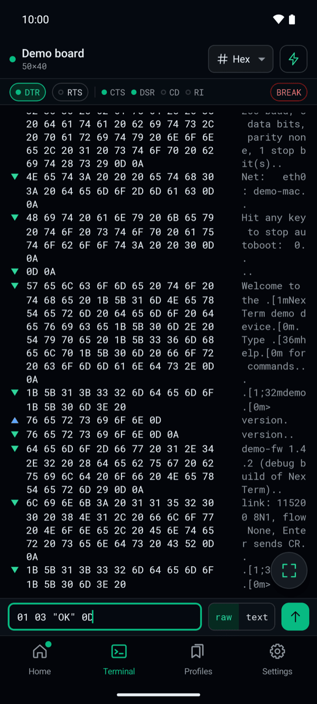
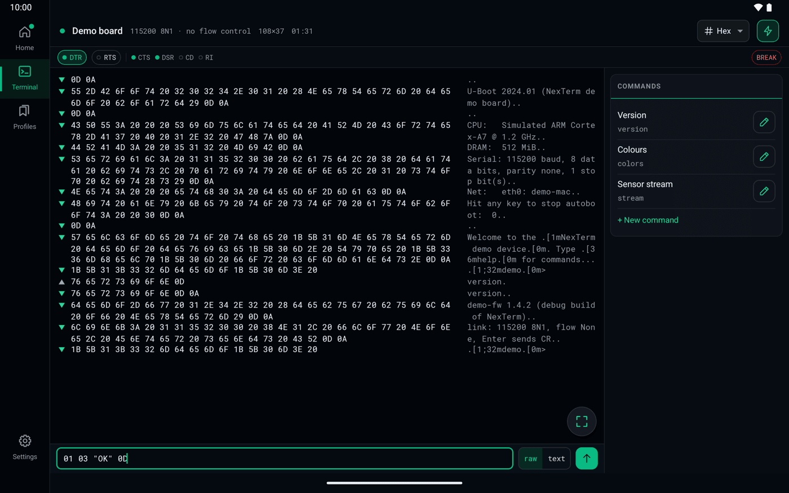
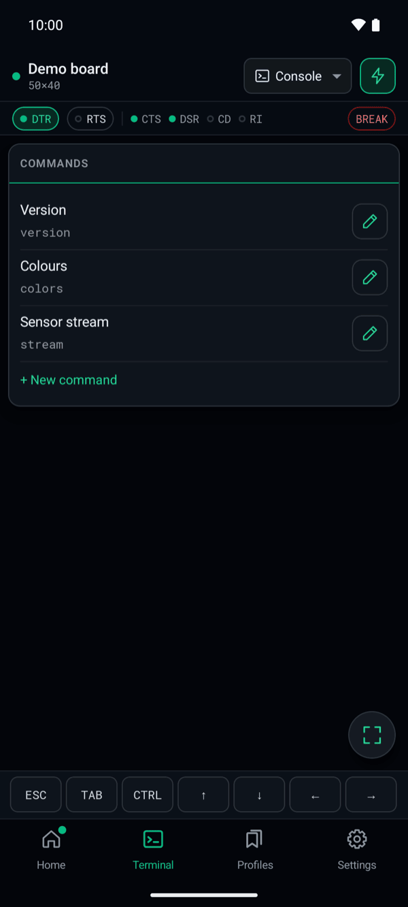
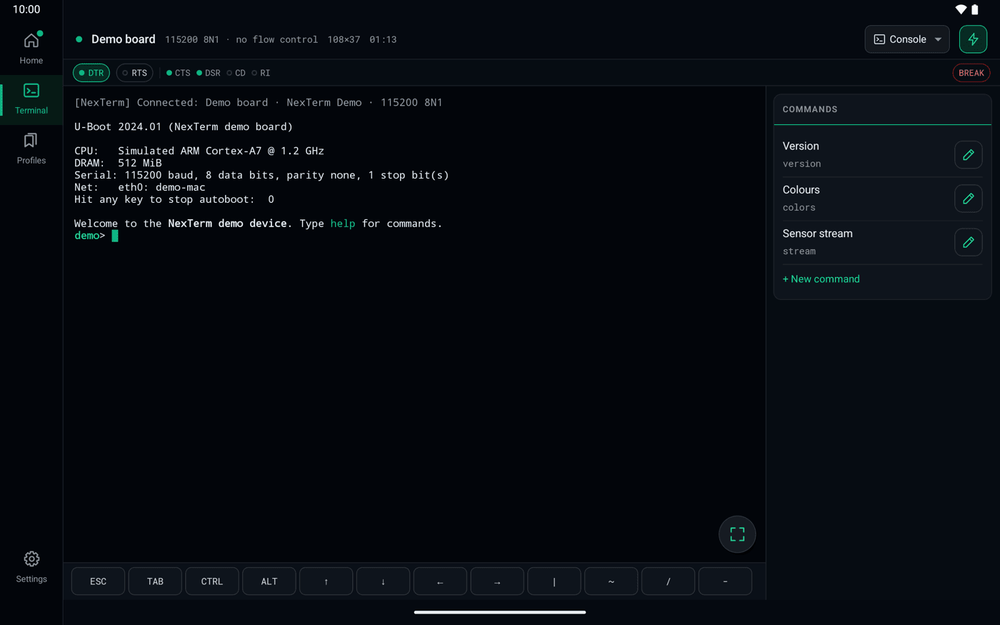
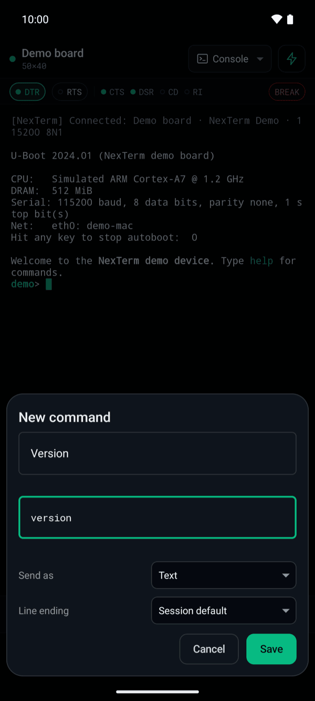
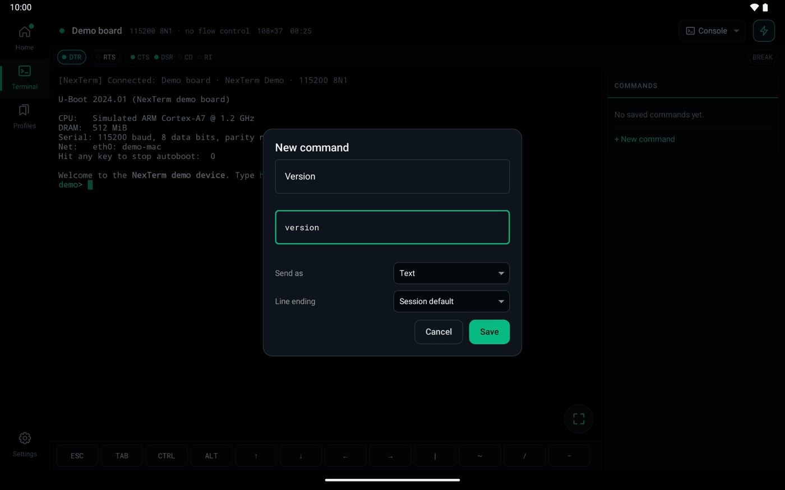

# Sending data

NexTerm sends in four ways: by typing in the Console, with the **send field** of Trace and Hex, in **raw bytes**, and with **saved commands**. This chapter covers the last three. The images enlarge with a click.

## Typing in the Console

What you type in the [Console](terminal.md#console) goes to the device key by key, and **Enter** sends the line ending of the profile: CR, LF or CR+LF. Most devices that take commands expect CR; if yours answers only to LF or to both, change “Enter sends” in the [profile](profiles.md).

## The send field of Trace and Hex

Trace has a field at the bottom, “Send text”, and a round button to send. Write the text and press the button: it goes out as **one message**, followed by the line ending you chose. The label next to the field (**CR** at first) is that line ending. Tap it to switch between CR, LF and CR+LF; the change is for this session only, and the profile does not change.

A message sent from here shows in Trace as a single line with a blue triangle, where typing in the Console would show one message for each key.

## Raw bytes

When the device speaks a binary protocol, Hex has the switch **raw | text** next to its field. In **raw** you write bytes, and they are sent **exactly as written**, with nothing added: no line ending.

A line mixes hexadecimal bytes and text in quotes:

```text
01 03 "OK" 0D 0A
```

sends the bytes 01, 03, the two letters O and K, then 0D and 0A. The spaces between the bytes are free and the letters of the hex digits can be upper or lower case. Inside quotes, `\r`, `\n`, `\t`, `\\` and `\"` stand for a carriage return, a line feed, a tab, a backslash and a quote, and the text goes out as UTF-8. If something is wrong the field says what: “Use hex pairs like 01 03, or "text" in quotes.” for digits that do not make pairs, “A quote is not closed.”, or “Unknown escape. Use \r \n \t \\ or \".” The full rules are in [Raw bytes syntax](../reference/raw-bytes.md).

=== "Phone"

    [{ width="300" loading=lazy }](img/sending-3-raw.png){ target=_blank }

=== "Tablet"

    [{ loading=lazy }](img/sending-3-raw-tablet.png){ target=_blank }

In **text** mode the field sends plain text with the line ending, as Trace does.

## Saved commands

The commands you send again and again can be kept for one tap. The bolt button of the Terminal header opens the list: a **popup** on a phone, and a **dock** beside the terminal on windows 1000 dp wide or more, such as a tablet. The same list is shared by all the profiles.

=== "Phone"

    [{ width="300" loading=lazy }](img/sending-2-commands.png){ target=_blank }

=== "Tablet"

    [{ loading=lazy }](img/sending-2-commands-tablet.png){ target=_blank }

- **Tap a command** to send it. On a phone the popup closes.
- **Tap the pencil** to edit it.
- **+ New command** opens the editor with nothing in it. The list starts empty.

The editor asks for:

| Field | What it is |
|---|---|
| Name | What the list shows. |
| Command | What to send: text, or hex bytes when “Send as” is Hex. |
| Send as | **Text**, or **Hex bytes**, which follow the same rules as raw bytes above. |
| Line ending | After the text: Session default (the one of the send field of Trace), CR, LF, CR+LF or None. Not available for Hex bytes, which never get a line ending. |

**Delete** is in the editor of an existing command, and asks before it removes it.

=== "Phone"

    [{ width="300" loading=lazy }](img/sending-1-editor.png){ target=_blank }

=== "Tablet"

    [{ loading=lazy }](img/sending-1-editor-tablet.png){ target=_blank }

!!! tip "Whatever the view"
    The saved commands are available from the Console, Trace and Hex alike.
