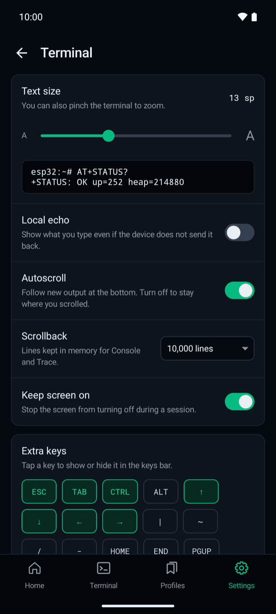
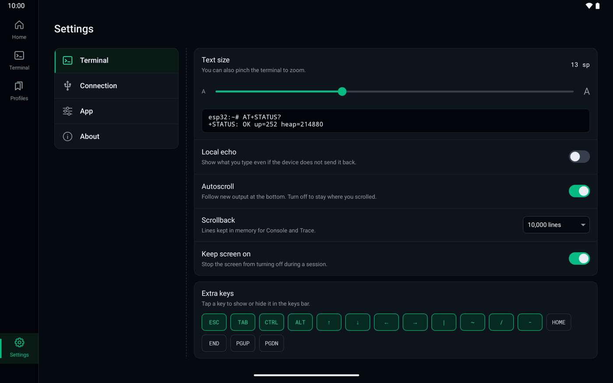
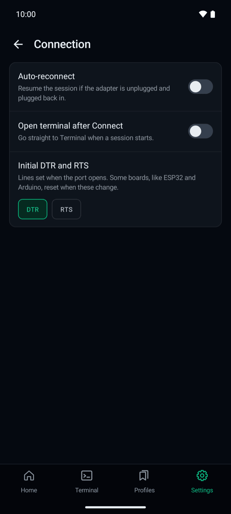
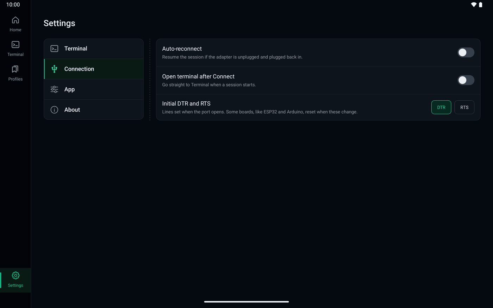
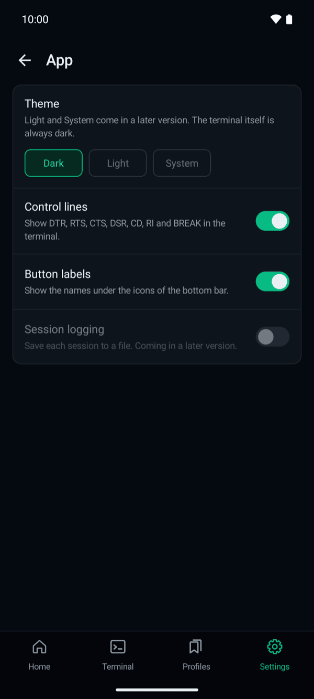
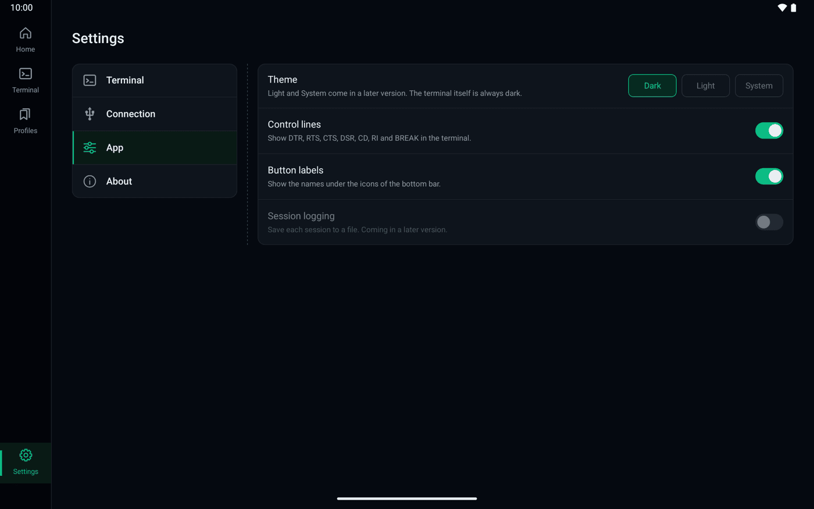

# Settings

The settings are in four sections: **Terminal**, **Connection**, **App** and **About**. They apply at once and are kept on the device. The images enlarge with a click.

How the screen is laid out depends on the width of the window:

- **under 600 dp** (a phone held upright): a list of the sections, each opening its own page with a back arrow;
- **600 to 840 dp** (a tablet held upright): the sections as a grid at the top and the settings below;
- **840 dp and more**: the list of the sections on the left and the settings on the right.

## Terminal

=== "Phone"

    [{ width="300" loading=lazy }](img/settings-2-terminal.png){ target=_blank }

=== "Tablet"

    [{ loading=lazy }](img/settings-2-terminal-tablet.png){ target=_blank }

| Setting | What it does | At first |
|---|---|---|
| Text size | The size of the text of the terminal, from 7 to 24 sp, with a sample under the slider. Pinching the terminal changes the same setting. | 13 sp |
| Local echo | Shows what you type even if the device does not send it back. | Off |
| Autoscroll | Console, Trace and Hex follow the new output at the bottom. Turn it off to stay where you scrolled. | On |
| Scrollback | The lines kept in memory for Console and Trace: 1,000, 5,000, 10,000 or 50,000. A change applies from the next connection. | 10,000 |
| Keep screen on | Stops the screen from turning off during a session. | On |
| Extra keys | The keys of the row under the console: ESC, TAB, CTRL, ALT, the four arrows, <code>&#124;</code>, `~`, `/`, `-`, HOME, END, PGUP and PGDN. Tap a key to show or hide it. | ESC, TAB, CTRL and the arrows on a phone; the first twelve, up to `-`, on a wide window |

## Connection

=== "Phone"

    [{ width="300" loading=lazy }](img/settings-3-connection.png){ target=_blank }

=== "Tablet"

    [{ loading=lazy }](img/settings-3-connection-tablet.png){ target=_blank }

| Setting | What it does | At first |
|---|---|---|
| Auto-reconnect | If the adapter is unplugged and plugged back in, the session resumes by itself. See [Home](home.md#when-a-session-ends). | Off |
| Open terminal after Connect | Goes straight to the Terminal when a session starts, instead of staying on Home. | Off |
| Initial DTR and RTS | The state of the two lines when the port opens. Some boards, like ESP32 and Arduino, reset when these change: see [Control lines and BREAK](control-lines.md). | DTR on, RTS off |

## App

=== "Phone"

    [{ width="300" loading=lazy }](img/settings-4-app.png){ target=_blank }

=== "Tablet"

    [{ loading=lazy }](img/settings-4-app-tablet.png){ target=_blank }

| Setting | What it does | At first |
|---|---|---|
| Theme | The app is dark. Light and System come in a later version, and the terminal is always dark. | Dark |
| Control lines | Shows DTR, RTS, CTS, DSR, CD, RI and BREAK in the terminal. | On |
| Button labels | Shows the names under the icons of the bottom bar and of the rail. Without them the bar is lower. | On |
| Session logging | Saves each session to a file. It is not there yet: the switch is off and cannot be turned on. | Off |

## About

The version of the app, its license (GNU General Public License v3), and the open-source libraries it uses, with their licenses. They are also listed in [About](../about.md).
