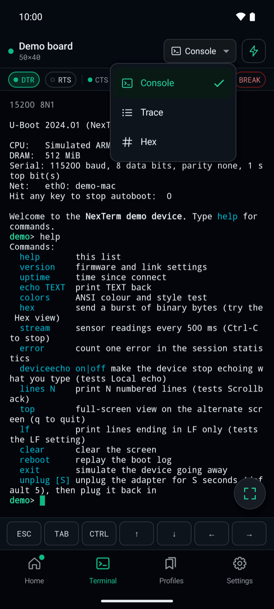
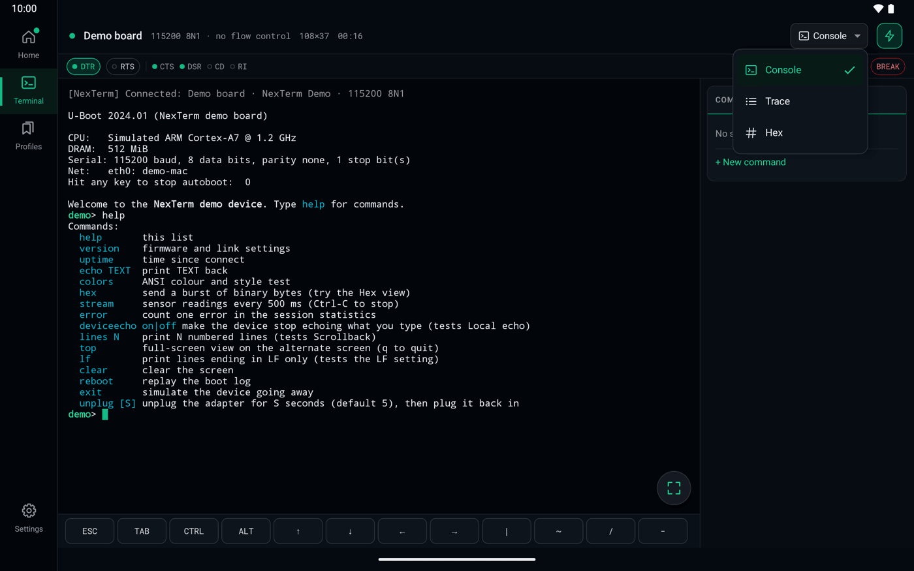
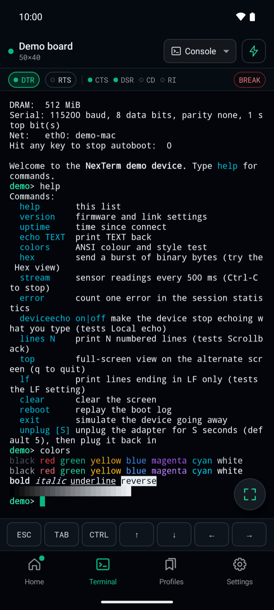
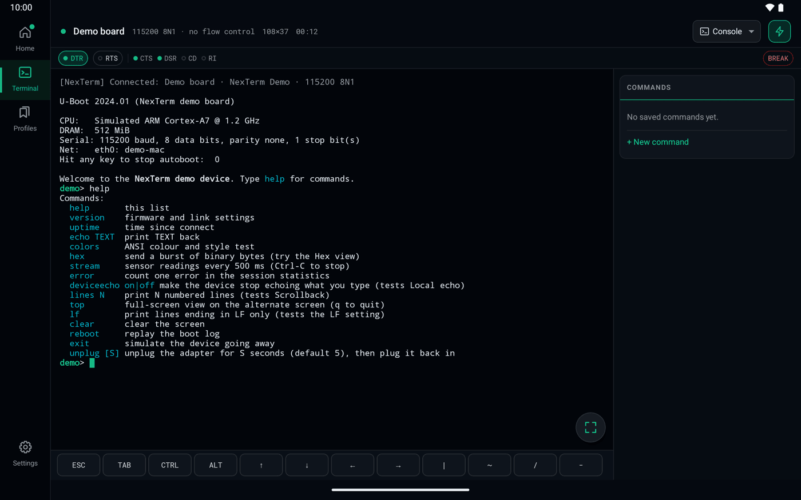
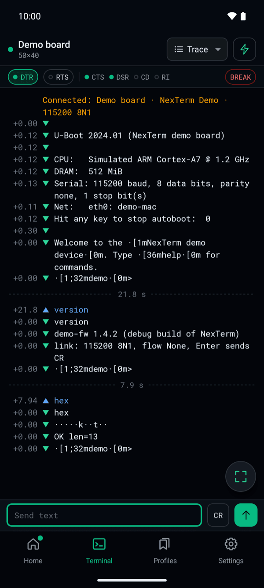
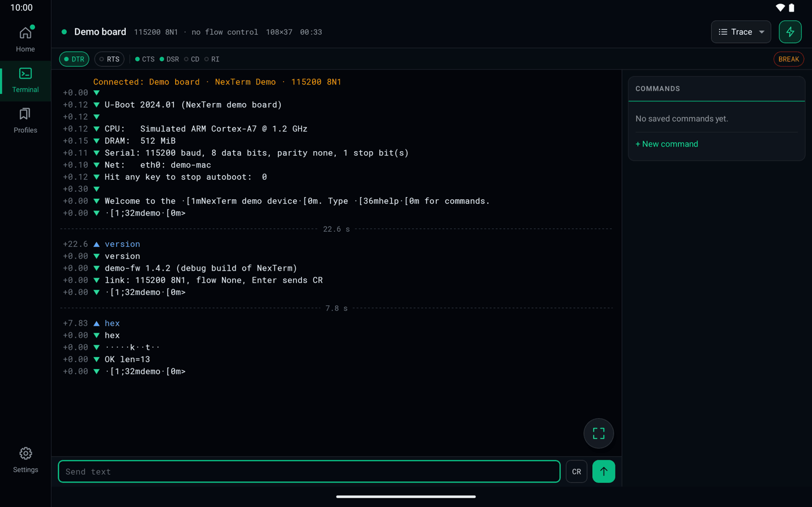
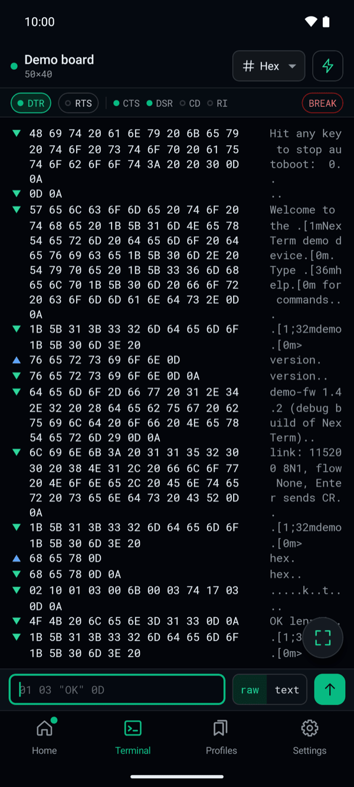
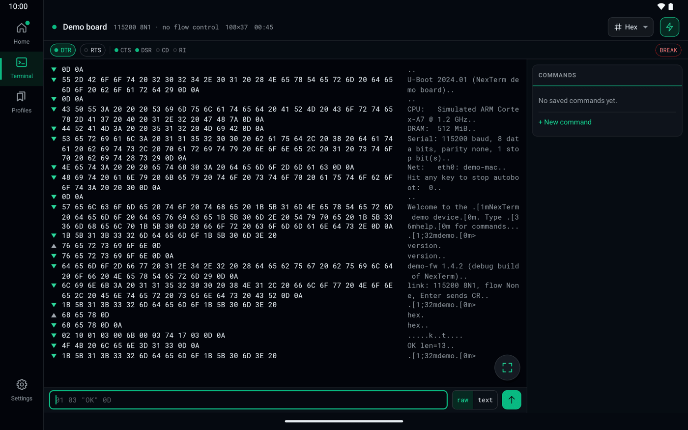

# Terminal: Console, Trace and Hex

The **Terminal** screen shows what the device sends and lets you answer. It has three **views** of the same traffic: the **Console** is a terminal, **Trace** lists the messages one by one with their direction and timing, and **Hex** shows the bytes. Changing view loses nothing, because all three are drawn from the same record of the session. The images enlarge with a click.

!!! info "A session comes first"
    The Terminal works on a session: connect an adapter first, as in [First connection](../start/first-connection.md). Without one it says “No active session” and sends you to Home.

## The header

At the top of the screen, from left to right:

- a green lamp while the session is connected, and the **name of the profile**, or “Quick connect” when you connected without saving one;
- the **size of the terminal** in columns and rows, for example 50×40, under the name on a narrow screen. It changes with the rotation, the keyboard and the text size: a serial link cannot tell the device about it, so a program that draws on the whole screen may need the size set on the device;
- on a tablet, and on any window 600 dp wide or more, also the serial settings (“115200 8N1 · no flow control”) and how long the session has lasted;
- the **view button**, which opens the choice between Console, Trace and Hex, and the **bolt button**, which opens the saved commands ([Sending data](sending.md)).

Under the header, the bar of the [control lines](control-lines.md).

=== "Phone"

    [{ width="300" loading=lazy }](img/terminal-2-views.png){ target=_blank }

=== "Tablet"

    [{ loading=lazy }](img/terminal-2-views-tablet.png){ target=_blank }

## Console

The Console is a **VT100/ANSI terminal**, built on the terminal emulator of Termux. It draws colours, bold, italic, underlined and reversed text, moves the cursor and runs full-screen programs, so a Linux shell on a board or a boot loader behaves as it would on a computer.

=== "Phone"

    [{ width="300" loading=lazy }](../start/img/first-connection-4-console.png){ target=_blank }

=== "Tablet"

    [{ loading=lazy }](img/terminal-1-console-tablet.png){ target=_blank }

- **Typing.** Tap the console to bring up the keyboard. What you type goes to the device, and **Enter** sends the line ending chosen in the profile (CR, LF or CR+LF). When the session has ended the console only shows the last transcript, and a tap no longer opens the keyboard.
- **Local echo.** Most devices send back what they receive, and that is what you see. If yours does not, turn on [Local echo](settings.md#terminal): NexTerm then draws the text you type, a new line for Enter, and a step back for Backspace. Cursor keys and Ctrl combinations show nothing.
- **Extra keys.** Under the console there is a row of keys that a phone keyboard lacks: ++esc++, ++tab++, ++ctrl++, ++alt++, the arrows, `|`, `~`, `/`, `-`, ++home++, ++end++, ++page-up++ and ++page-down++. You choose which ones are shown in the [Settings](settings.md#terminal). **Ctrl** and **Alt** stay pressed for one key: tap Ctrl, then C, to send Ctrl-C.
- **Zoom.** Pinch the console to make the text smaller or larger, from 7 to 24 sp. The size is the one of the Text size setting, so it stays.
- **Full screen.** The round button in the corner of the terminal hides the header and the bars so that the terminal has the whole window; the same button brings them back. You can drag it where it is not in the way, and NexTerm remembers its place for each orientation.
- **Scrolling.** Drag to look at what has gone by. With **Autoscroll** on (the default) the Console, Trace and Hex jump to the newest output as it arrives; turn it off in the Settings to stay where you are until you scroll. The **Scrollback** setting says how many lines are kept.

## Trace

Trace lists the traffic as **messages**: a run of bytes that went one way. A message ends at a line feed, or when the data stops for a moment, so a line that the adapter hands over in several pieces is still one message.

=== "Phone"

    [{ width="300" loading=lazy }](img/terminal-3-trace.png){ target=_blank }

=== "Tablet"

    [{ loading=lazy }](img/terminal-3-trace-tablet.png){ target=_blank }

Each line has, from left to right:

- the **time since the message before**, in seconds (“+0.12”);
- a **triangle** for the direction: blue and pointing up for what you **sent**, green and pointing down for what you **received**;
- the **text** of the message. Printable characters are shown as they are, every other byte as a dot, and the line ends are left out. A received line that starts with “ERR” is drawn in red.

A dashed rule with a time, such as “21.8 s”, marks a pause longer than three seconds, and notes from NexTerm itself (“Connected”, “Disconnected”) appear in amber.

At the bottom, the **send field** sends text. The label next to it, **CR** at first, is the line ending: tap it to change it between CR, LF and CR+LF for this session only (the profile does not change). More in [Sending data](sending.md).

## Hex

Hex shows the same messages as **bytes**. Each message is a group of rows with the bytes in hexadecimal on the left and their text on the right, a dot standing for a byte that is not printable. A row holds as many bytes as fit the width of the screen, and the triangle of the direction is on the first row of each message.

=== "Phone"

    [{ width="300" loading=lazy }](img/terminal-4-hex.png){ target=_blank }

=== "Tablet"

    [{ loading=lazy }](img/terminal-4-hex-tablet.png){ target=_blank }

The send field of Hex has a switch, **raw** and **text**. In **raw** you write bytes, as in `01 03 "OK" 0D`, and they are sent exactly as written; in **text** you write plain text, which goes out with the line ending like in Trace. The rules of the raw syntax are in [Raw bytes syntax](../reference/raw-bytes.md).

## When the session ends

If you disconnect, or the adapter is unplugged, the terminal stays on the screen as a read-only transcript, with a bar under it that says “Session ended. This is the last transcript.” and a **Reconnect** button. If [Auto-reconnect](settings.md#connection) is on and the adapter was unplugged, the bar says “Waiting for the adapter. The session resumes when it is plugged back in.”

Next: [Sending data](sending.md) and [Control lines and BREAK](control-lines.md).
