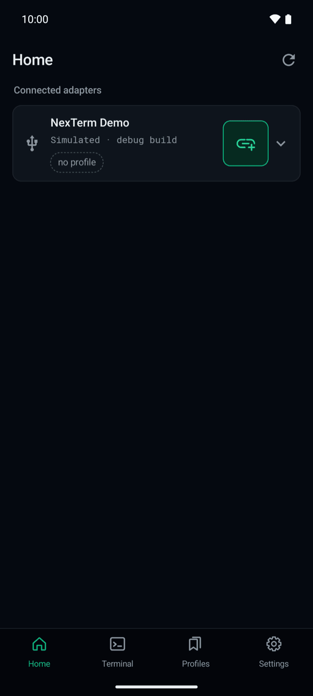
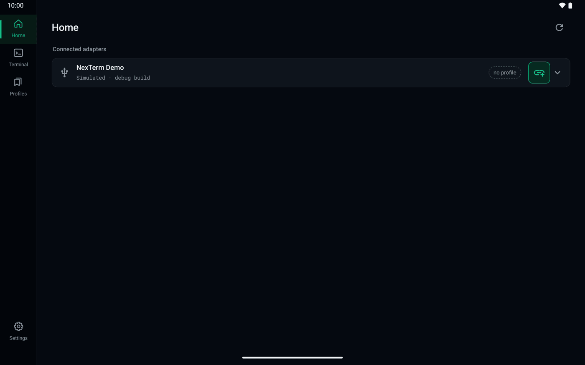
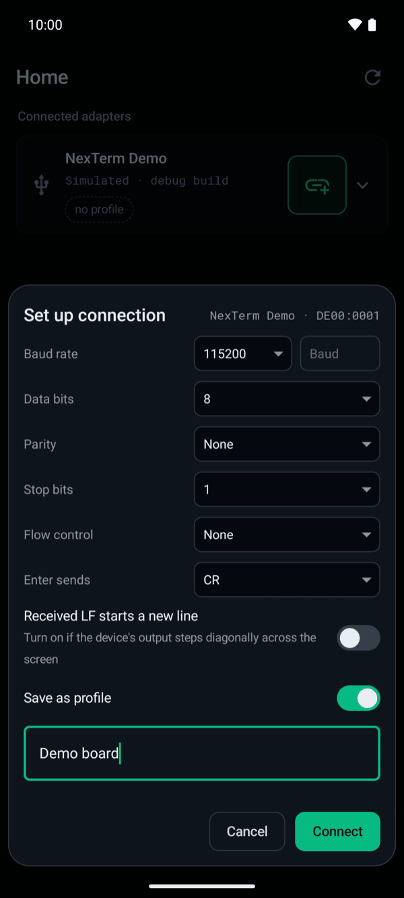
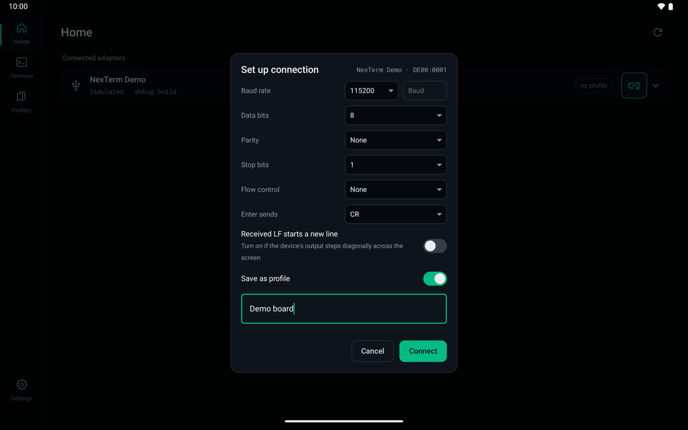
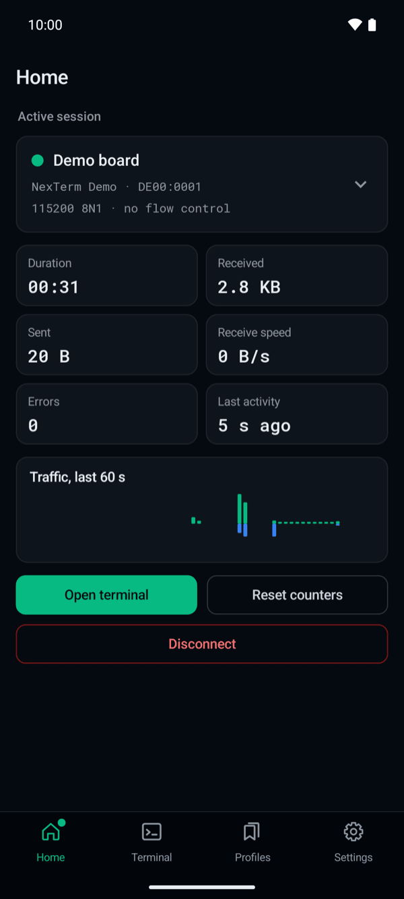
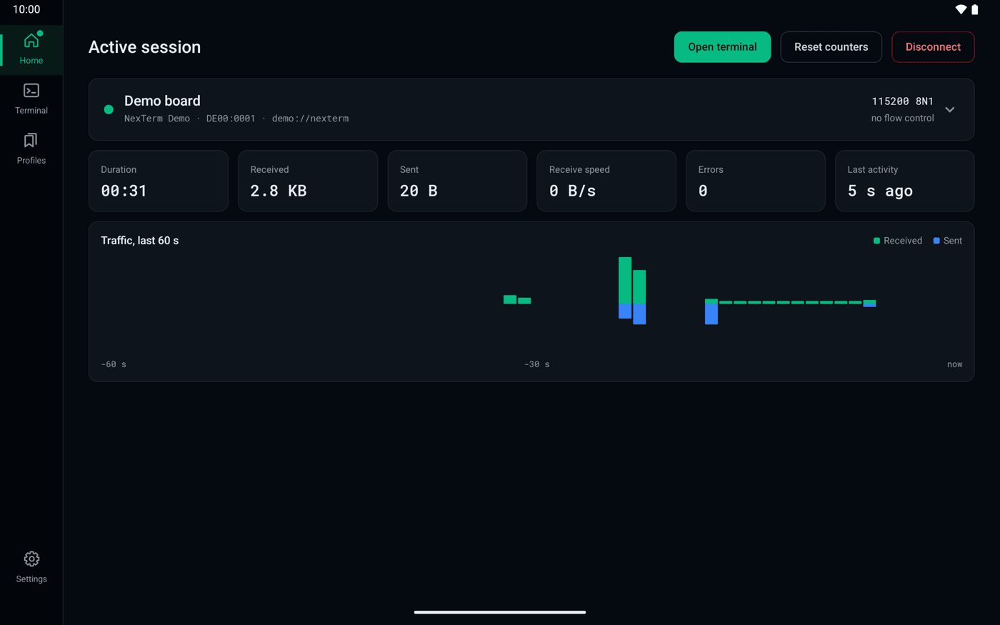
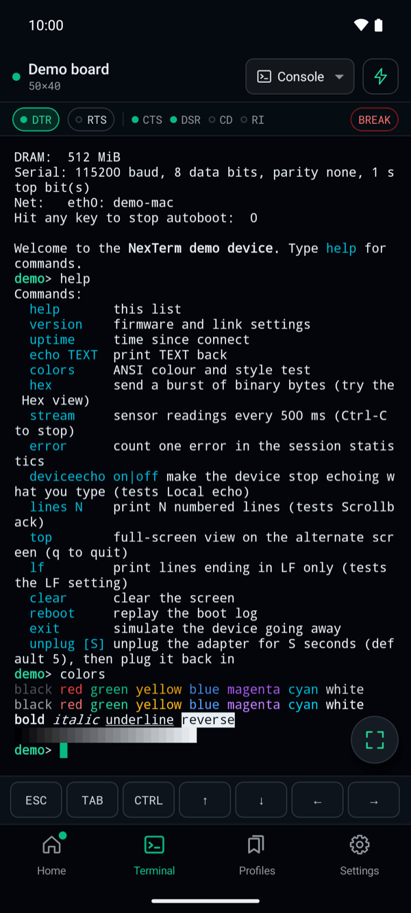
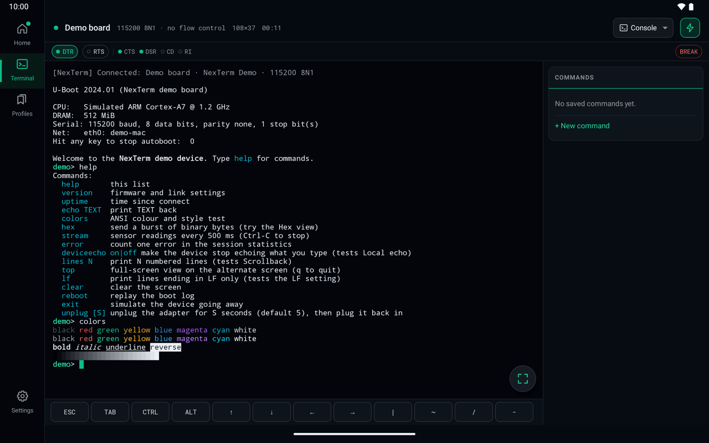

# First connection

This chapter takes you from a plugged-in adapter to the first line on the screen. Any USB serial adapter will do, and so does a board with a USB port of its own that shows up as a serial port. The chapters of the [User guide](../guide/interface.md) explain each screen in detail. The images enlarge with a click, and they come in two versions, for a phone and for a tablet: choose the one you use.

!!! info "Before you start"
    NexTerm must be [installed](install.md), and the cable and the adapter must be [ready](requirements.md). NexTerm does not start when you plug an adapter in, so open it yourself.

!!! note "The adapter in the pictures"
    The screenshots were taken with a simulated adapter called “NexTerm Demo”, so that no real device is shown. Yours will have its own name.

## 1. Plug in the adapter

Join the OTG cable to the phone, the adapter to the cable, and the adapter to the device you want to talk to. Then open NexTerm.

The **Home** screen lists the **Connected adapters**. Each card gives the name of the adapter, its **VID:PID** (the USB identifier that tells one chip from another) and the profile it will use, or “no profile”. The list follows you plugging and unplugging, and the refresh button at the top forces it. Tap a card to see its details: manufacturer, product, serial number, path, the driver NexTerm will use, the control lines and the flow control modes that the driver can handle, and whether the USB permission was given.

=== "Phone"

    [{ width="300" loading=lazy }](img/first-connection-1-adapters.png){ target=_blank }

=== "Tablet"

    [{ loading=lazy }](img/first-connection-1-adapters-tablet.png){ target=_blank }

If the list says “No adapter connected”, see [Troubleshooting](../reference/troubleshooting.md).

## 2. Set it up

An adapter that has no profile yet has a **Set up…** button on its card. It opens the **Set up connection** form, where you say how the device talks:

| Setting | What it is |
|---|---|
| Baud rate | The speed, in bits per second: a list from 300 to 1,500,000, or “Custom…” for another value. At first, 115200. |
| Data bits | 5, 6, 7 or 8. At first, 8. |
| Parity | None, Even, Odd, Mark or Space. At first, None. |
| Stop bits | 1 or 2. At first, 1. |
| Flow control | None, RTS/CTS or XON/XOFF. At first, None. |
| Enter sends | What the Enter key sends: CR, LF or CR+LF. At first, CR. |
| Received LF starts a new line | Turn it on if the output of the device steps diagonally down the screen. Off at first. |

Adapters with more than one port, such as some FTDI chips, also have a **Port** choice.

The usual “115200 8N1” suits most boards, but the right values are the ones the device is set to: if the text comes out as garbage, the speed is the first thing to check. The form starts with the values of the last connection you made without a profile.

**Save as profile** is on by default: give it a name and next time the adapter has a **Connect** button that does everything in one tap. Turn it off to connect just this once. [Profiles](../guide/profiles.md) explains how to keep several of them.

=== "Phone"

    [{ width="300" loading=lazy }](img/first-connection-2-setup.png){ target=_blank }

=== "Tablet"

    [{ loading=lazy }](img/first-connection-2-setup-tablet.png){ target=_blank }

## 3. Connect

Press **Connect** in the form. Two things can happen the first time:

- On Android 13 and newer, Android asks whether NexTerm may show notifications. They are only the ongoing notification of an open session, with a Disconnect button: say yes or no, NexTerm works either way.
- NexTerm explains that it needs **USB access** and, when you tap **Continue**, Android asks whether NexTerm may use the adapter. Tap **OK**.

!!! note "Android asks again after every re-plug"
    The permission lasts until the adapter is unplugged, so you are asked again each time you plug it back in. It is the price of not letting NexTerm open by itself when an adapter is connected.

If something goes wrong, a “Couldn't connect” window says why.

## 4. Use the terminal

When the session is open, **Home** shows the **Active session** with its statistics, and the button **Open terminal** takes you to the **Terminal**. If you would rather land in the terminal right away, turn on “Open terminal after Connect” in the [Settings](../guide/settings.md).

=== "Phone"

    [{ width="300" loading=lazy }](img/first-connection-3-session.png){ target=_blank }

=== "Tablet"

    [{ loading=lazy }](img/first-connection-3-session-tablet.png){ target=_blank }

What the device prints appears on the screen. Tap the console to bring up the keyboard: what you type goes to the device, and **Enter** sends the line ending you chose in the form. If you do not see what you type, the device is not echoing it: turn on **Local echo** in the Settings.

=== "Phone"

    [{ width="300" loading=lazy }](img/first-connection-4-console.png){ target=_blank }

=== "Tablet"

    [{ loading=lazy }](img/first-connection-4-console-tablet.png){ target=_blank }

## 5. Disconnect

**Disconnect** on Home, or the button of the notification, ends the session. Home keeps the ended session, with **Reconnect** to open it again (the same adapter and profile, with the counters back to zero) and **Close** to go back to the list of adapters.

If the adapter is unplugged, the session ends too, and Home says so. With **Auto-reconnect** on (Settings, Connection) it waits instead, with a notification, and resumes by itself when you plug the adapter back in: you only have to tap **OK** on Android's permission window again.

## And then

1. [Interface tour](../guide/interface.md): the four screens of the app and how they fit together.
2. [Profiles](../guide/profiles.md): keeping the settings of each adapter.
3. [Terminal](../guide/terminal.md) and [Sending data](../guide/sending.md): the three views, text and raw bytes, saved commands.
